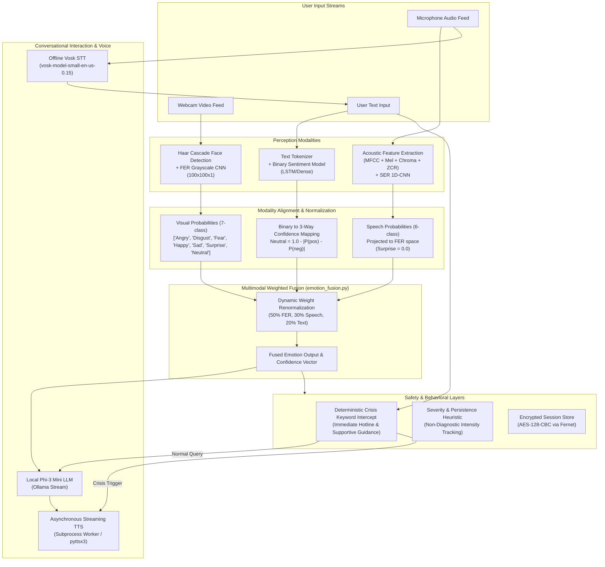

# EMOVISTA System Architecture & Technical Documentation

This document provides a comprehensive technical breakdown of the EMOVISTA multimodal emotion-aware conversational assistant, covering pipeline architecture, multimodal fusion algorithms, safety frameworks, and security hardening.

---

## 1. High-Level System Architecture

---

## 2. Multimodal Perception Pipelines

### A. Facial Expression Recognition (FER)
- **Face Localization**: OpenCV Haar Feature-based Cascade Classifier (`haarcascade_frontalface_default.xml`).
- **Input Preprocessing**: Region of interest (ROI) cropped, resized to $100 \times 100$, converted to 1-channel grayscale, and normalized to float values in $[0.0, 1.0]$.
- **Architecture**: Deep convolutional neural network (`models/Fer_model/fer_model.keras`):
  - 3 Conv2D blocks with BatchNormalization, ReLU activations, MaxPooling, and Dropout.
  - Dense hidden layer (Dropout 0.5) leading to a 7-unit Softmax output layer.
- **Label Order**: Alphabetical ordering: `0: angry, 1: disgust, 2: fear, 3: happy, 4: neutral, 5: sad, 6: surprise`.

### B. Speech Emotion Recognition (SER)
- **Audio Processing**: 22,050 Hz sampling rate mono PCM audio, trimmed of silence.
- **Feature Extraction**: Concatenated 40-dimensional feature vector:
  - 40 MFCC mean coefficients
  - Mel-spectrogram power log means (128 bands)
  - Chroma STFT means
  - Zero-Crossing Rate (ZCR) mean
  - Spectral Centroid mean
- **Architecture**: 1D Convolutional Neural Network with L2 regularization (`1e-4`), BatchNormalization, Dropout (`0.35`), and Softmax across 6 CREMA-D classes (`angry`, `disgust`, `fear`, `happy`, `neutral`, `sad`).
- **Speaker Isolation**: Evaluated using `GroupShuffleSplit` on Actor ID to eliminate speaker identity leakage.

### C. Text Sentiment Analysis
- **Text Preprocessing**: Tokenized and sequence-padded to length 100.
- **Model**: Trained on binary sentiment data (`negative`, `positive`), generating confidence probabilities $p_{\text{pos}}$ and $p_{\text{neg}}$.
- **Confidence-Based 3-Way Projection**:
  In human conversation, sentiment neutrality frequently corresponds to low model confidence rather than strong affective neutrality. The projection maps binary sentiment to `[P(neg), P(neu), P(pos)]`:
  $$\text{Margin / Confidence: } C = |p_{\text{pos}} - p_{\text{neg}}| \in [0.0, 1.0]$$
  $$P(\text{neutral}) = 1.0 - C$$
  $$P(\text{negative}) = (1.0 - P(\text{neutral})) \times \frac{p_{\text{neg}}}{p_{\text{neg}} + p_{\text{pos}}}$$
  $$P(\text{positive}) = (1.0 - P(\text{neutral})) \times \frac{p_{\text{pos}}}{p_{\text{neg}} + p_{\text{pos}}}$$
  - Negative is mapped to `Sad`.
  - Neutral is mapped to `Neutral`.
  - Positive is mapped to `Happy`.

---

## 3. Multimodal Weighted Fusion Algorithm

The core fusion engine (`src/fusion/emotion_fusion.py`) combines the three modalities:

### Base Modality Weights
- Visual (FER): $W_{\text{fer}} = 0.50$
- Speech (SER): $W_{\text{speech}} = 0.30$
- Text: $W_{\text{text}} = 0.20$

### Dynamic Renormalization
Let $\mathcal{A} \subseteq \{\text{fer}, \text{speech}, \text{text}\}$ be the set of valid, active modalities present for a given frame or interaction. The renormalized weight $W_i'$ for modality $i \in \mathcal{A}$ is:
$$W_i' = \frac{W_i}{\sum_{m \in \mathcal{A}} W_m}$$

The combined 7-class emotion probability vector $\mathbf{P}_{\text{combined}}$ is computed as:
$$\mathbf{P}_{\text{combined}} = \sum_{i \in \mathcal{A}} W_i' \mathbf{P}_i$$

The dominant emotion label is selected via:
$$y^* = \text{fer\_labels}\left[\arg\max_j \mathbf{P}_{\text{combined}}[j]\right]$$

### Fallback Guarantee
If $\mathcal{A} = \emptyset$ (no valid inputs or corrupted data vectors), the system deterministically outputs:
$$\mathbf{P}_{\text{combined}} = [0, 0, 0, 0, 0, 0, 1.0] \quad (\text{Neutral})$$

---

## 4. Safety Architecture & Clinical Boundaries

### A. Non-Diagnostic Guarantee
EMOVISTA strictly avoids clinical psychiatric claims. The following terminology substitutions are enforced throughout:
- ❌ Depression $\to$ ✅ Low / Downhearted
- ❌ Anxiety $\to$ ✅ Worried / Heightened alertness
- ❌ Stress Disorder $\to$ ✅ Distressed / Tense
- ❌ Diagnosis $\to$ ✅ Automated conversational support heuristic

### B. Deterministic Crisis Protocol
To guarantee user safety, crisis handling does not rely on local LLM prompt compliance:
1. Every incoming text string is evaluated against a pre-compiled set of self-harm, suicidal ideation, and acute distress keywords (`src/web/backend/llm_phi3.py:is_crisis_text()`).
2. When triggered, the assistant bypasses LLM inference entirely and returns a validated, supportive crisis message directing the user to professional lifelines (e.g., 988 in the US/Canada, 111/999 in the UK, 112 in the EU).
3. The response is immediately rendered in the chat window and spoken aloud via TTS.

### C. Encrypted Session Store
Session data and emotion logs are stored locally in `data/memory/patient_memory.enc`. Encryption uses Fernet (AES-128 in CBC mode with PKCS7 padding and HMAC-SHA256 authentication). Encryption keys are stored in `data/memory/patient.key` and strictly excluded from Git tracking via `.gitignore`.

---

## 5. Web API Hardening

The Flask application (`app.py`) includes the following production-grade protections:
- **Debug Mode**: Disabled by default (`FLASK_DEBUG=false`), preventing interactive debugger code execution.
- **Explicit CORS**: Restricted to local development origins (`http://localhost:5000`, `http://127.0.0.1:5000`).
- **Image Input Validation (`/analyze_face`)**:
  - Request body capped at 5 MB (`Config.MAX_IMAGE_SIZE_BYTES`).
  - Base64 validation catching `binascii.Error` and malformed data URLs.
  - Image decoding verification preventing OpenCV segmentation faults.
- **TTS Endpoint Protection (`/tts`)**:
  - Validates JSON payload and non-empty string types.
  - Limits text length to 1,000 characters to prevent subprocess buffer exhaustion.
- **Speech Degradation (`/stt`)**:
  - Returns HTTP 503 Service Unavailable with setup instructions when Vosk models or audio input devices are unavailable, allowing the rest of the application to operate uninterrupted.

---

## 6. Verification & Test Suite

The system includes a dedicated unit and integration test suite:
- `tests/test_fusion.py`: 9 unit tests verifying all-present, single-missing, all-missing, malformed vector lengths, binary confidence mapping, and surprise modality exclusivity. Runs with zero deep learning dependencies.
- `tests/test_web_app.py`: 12 integration tests exercising API endpoints, security bounds, malformed payloads, crisis interception, and graceful speech degradation.
- `scripts/evaluate_fer.py`: Inspects model architecture, reports validation accuracy from training logs, and runs synthetic probe evaluations.
